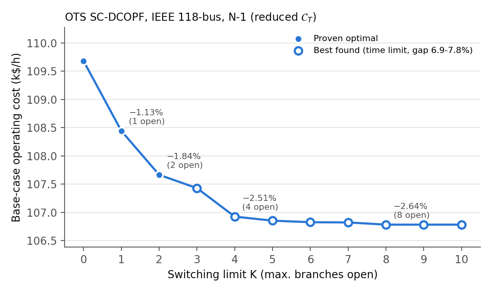

# OTS-SC-DCOPF — Results Notes (IEEE 118-bus, MATPOWER data)

> Tracking of results and open decisions. Numeric CSVs live under
> `<case>/results/<source>/<formulation>/<config>/<K>/` (see `README.md` for the case folders).
> This file is for notes and interpretation.
>
> **Code names in this file** (`ots-sc-dcopf.ipynb`, `sweep_k.py`, `solution-quality/`,
> `core_screening.py`, ...) refer to the code that produced these results, now in
> `old/pre-reorg-2026-11/` (reorganization of 2026-11-16).
>
> **Current model** (thesis section 3.3; used in §1 only). SC-DCOPF (`reference-k0/`) with a
> **preventive** N-1 criterion plus preventive transmission switching:
> - Objective: base-case cost only, $\min \sum_g c_g P_{g,0} S_{base}$ (no contingency
>   probabilities, as in Hedman et al. 2009).
> - States $\mathcal{C} = \{0\} \cup \mathcal{C}_T \cup \mathcal{C}_G$. Branch contingencies:
>   $P_{g,c} = P_{g,0}$. Generator contingencies: lost power picked up by capacity-proportional
>   participation factors $\alpha_{g,c} = P_g^{\max} / \sum_h N1_{h,c} P_h^{\max}$.
> - Thermal limit $F^{\max}$ in the base case, $F^{em} = 1.15\,F^{\max}$ post-contingency
>   (`EMERG_FACTOR`). Angle limits $\pm 0.6$ rad on every bus and state (`THETA_MAX`).
> - One binary $z_{ij}$ per switchable branch ($\mathcal{L}^S$: 177 non-radial branches), shared by
>   every state; the 9 radial branches are fixed closed. $\sum_{\mathcal{L}^S}(1-z_{ij}) \le K$.
>   Per-branch big-M $M_{ij} = (\theta^{\max}-\theta^{\min})/x_{ij}$. $\mathcal{C}_T$ is defined on
>   the original topology.
>
> **Legacy model** (§2–§3, kept for history): expected-cost objective weighted by $\rho$
> (`RHO_GEN = 1e-2`, `RHO_LINE = 1e-3`), corrective redispatch, no angle limits, big-M from
> $\Delta\theta^{\max}$ = 90° or 180°. **Costs in §2–§3 are not comparable with §1.**

---

## 0. Analysis map

Each case study answers four questions. Everything else is a tool for one of them.

| # | Question | Study case / folder | Status |
|---|---|---|---|
| 1 | Cost of N-1 security without switching (K = 0) | Reference, `reference-k0/` | done |
| A | How much does the OTS reduce the cost, with how many openings? (reduced $\mathcal{C}_T$) | CS1a, `cs1a-k-sweep/` | sweep K = 0–10 done (§1) |
| A+ | Can the solutions of A be improved? Which contingencies limit the cost? | CS1a, `cs1a-k-sweep/` | in progress (§1.5); heuristic warm start next |
| — | How do the savings change with the load level? | CS1b, `cs1b-load-levels/` | to do |
| B | With the full $\mathcal{C}_T$, which K makes the problem feasible? | CS2, `cs2-full-n1/` | K ≤ 3 proven infeasible |
| R | Renewable siting and curtailment | CS3, `cs3-renewables/` | to do |
| V | Are the OTS solutions right? (pandapower, brute force K = 1) | `validation/` | to do |

How the results so far were produced (old code, now in `old/pre-reorg-2026-11/ots-sc-dcopf/`):

- `ots-sc-dcopf.ipynb`: the OTS model, one K per run. Used by A and B (separated by
  `FORMULATION`, so their results never overwrite each other).
- `sweep_k.py`: runs the notebook for a range of K. `plot_k_sweep.py`: the K-sweep figure
  (→ `figures/`).
- `<config>_improved/` holds the solutions improved by `solution-quality/`.
- `cs1a-k-sweep/logs/`: console logs of the sweep runs.
- **Warm start** (`ots-sc-dcopf.ipynb`, §6.1): each K starts from the cheapest saved result with
  $K' \le K$, looking in `<config>/` and `<config>_improved/`. If there is none, it uses the
  topology of `core_screening.py` (Analysis B). The warm start only gives Gurobi a starting
  point; it does not change the model or the optimum.

---

## 1. K sweep — `redispatch_with_exclusions/contingencies` (current model)

**State set:** base + line contingencies + generator contingencies, minus the three that make the
fixed-topology SC-DCOPF infeasible (`EXCLUDE` in `ots-sc-dcopf.ipynb`, `HARD` in
`full-ct-feasibility/core_screening.py`): line **8-5**, line **38-65**,
and the **bus-10 generator** (505 MW). 194 states in total.

**Runs** (Gurobi 13.0.2, `MIPFocus=1`, `NoRelHeurTime=300`, `Cuts=1`, `MIPGap=1e-4`):

1. Cluster run (commit `0a8ad3f`, 9 parallel jobs, 3 threads, 6 h per K), every K warm-started
   from the K = 1 solution.
2. Local chained run (2026-11, i7-1360P, 16 threads, 2.5 h per K, ~24 h in total): each K
   warm-started from the cheapest saved result with $K' \le K$ (commit `776120c`). K3–K10 were
   overwritten by this run; K0–K2 are from the cluster run.

For K ≥ 3 the reported `runtime_s` is the last run only. The total search was 6 h + 2.5 h.

### 1.1 Results

(`python plot_k_sweep.py` → `figures/k_sweep_redispatch_with_exclusions_contingencies.png` / `.pdf`.)

| K | Cost ($/h) | Δ vs K−1 | Saving vs K0 | Status | Best bound | Time (s) | Lines opened |
|---|---|---|---|---|---|---|---|
| 0 | 109,681.25 | — | — | optimal | — | 454 | — |
| 1 | 108,442.22 | −1,239.03 | 1.13% | optimal | — | 1,950 | 64-65 |
| 2 | 107,665.95 | −776.27 | 1.84% | optimal | — | 8,182 | 64-65, 77-80 |
| 3 | 107,429.97 | −235.98 | 2.05% | time limit, gap 6.9% | 100,016 | 9,001 | 64-65, 77-80, 92-94 |
| 4 | 106,925.70 | −504.27 | 2.51% | time limit, gap 7.7% | 98,689 | 9,000 | 64-65, 68-69, 77-80, 103-105 |
| 5 | 106,854.58 | −71.12 | 2.58% | time limit, gap 7.1% | 99,223 | 9,001 | K4 + 103-104 |
| 6 | 106,826.95 | −27.63 | 2.60% | time limit, gap 7.3% | 99,019 | 9,000 | K5 + 15-19 |
| 7 | 106,822.62 | −4.33 | 2.61% | time limit, gap 7.4% | 98,884 | 9,000 | K6 + 11-12 |
| 8 | 106,784.01 | −38.61 | 2.64% | time limit, gap 7.4% | 98,865 | 9,000 | K7 + 89-92 |
| 9 | 106,784.01 | 0 | 2.64% | time limit, gap 7.8% | 98,462 | 9,001 | same as K8 (8 open) |
| 10 | 106,784.01 | 0 | 2.64% | time limit, gap 7.8% | 98,406 | 9,001 | same as K8 (8 open) |

### 1.2 Checks

- **K = 0 reproduces the SC-DCOPF** (`reference-k0/results/.../redispatch_with_exclusions/contingencies`,
  $109,681.25/h). ✔
- **Cost is non-increasing in K.** ✔ (Only after the chained warm start, see §1.4.)
- K1 ⊂ K2 (nested, both proven optimal). From K4 on the solutions are nested again
  (K4 ⊂ K5 ⊂ … ⊂ K8).
- **Do not report the nesting as a property of the problem.** OTS optima need not be nested,
  and part of it comes from the warm start:
  - K1 ⊂ K2 is real (both proven optimal).
  - K4 was found **independently** of K3: the cluster run (warm start from K1 only) reached the
    same K4 set. So "K4 contains the K2 lines" is evidence of a common core (64-65, 77-80).
  - K5–K10 started from K − 1 (chained warm start) and are not proven optimal, so "K = K − 1
    plus one line" is at least partly an effect of the starting point. The cluster run without
    the chain found different (worse) sets for K5–K10.
  - The saved K3 (92-94) is not nested; the improved K3 (68-69, §1.5) is.
  - In the thesis: "the solutions share a core of openings (64-65, 77-80), and larger K add
    lines to it", not "the solutions are nested".
- No island check has been done on these topologies yet (§5.3).

### 1.3 Interpretation

- **Most of the gain comes with few openings:** K = 2 captures 70% of the best saving found
  ($2,015 of $2,897/h), K = 4 captures 95%. From K5 to K10 the gain is < $75/h (< 0.07%), so the
  curve is flat in practice.
- **K3 is probably suboptimal.** The step K3→K4 (−$504) is larger than K2→K3 (−$236), which is
  unusual for diminishing returns. K4 is not a superset of K3 either (it drops 92-94 and adds 68-69
  and 103-105). **Confirmed in §1.5:** a better K3 exists ($107,004.79/h) and the knee moves to
  K = 3.
- **The ~7% gap comes from a weak bound, not a poor incumbent.** The K3 bound ($100,016/h) is
  below the proven K2 optimum, and the gap is larger than the whole OTS saving (2.6%). The bound
  comes from the big-M LP relaxation and says little about the true optimum. Report K ≥ 3 as
  "best solution found". Empirical support: K5–K10 add < 0.1%.
- **The base case is not congested:** the highest base-case loading is 86–88% (100-103 at K0;
  38-65 at K2/K8). The binding constraints are post-contingency, so "congestion relief" here means
  N-1 congestion.
- **Cost of security.** The base-only DCOPF costs $93,152.38/h, so the N-1 premium is
  $16,528.87/h (+17.7%). The OTS recovers **12.2% of that premium with K = 2** and **17.5% with
  K = 8**. Stated this way the result is stronger than "−2.6% of total cost", and the same metric
  can be used for the renewable cases.
- **Main dispatch lever:** the bus-12 unit, the most expensive in the system ($c_1$ = 124.58
  $/MWh, against ≤ 35 for every other unit). It runs at 77 MW at K0 because of the N-1
  constraints and drops to 48 MW at K2 (≈ $3,550/h gross). It is partly offset by shifting
  26→25 and 69→66/80/54. From K4 on, the cheap unit at bus 100 also rises (547 → 587 MW at K8),
  and at K8 the bus-103 unit leaves the dispatch (48.5 → 0 MW).
- **Geography.** The case118 load and cheap generation are not strongly separated, which fits
  the modest cost saving. The renewable case studies (concentrated vs. distributed) test this
  hypothesis; this result alone does not prove it.

### 1.4 Computational notes on the sweep

- Model: 224,062 rows, 62,848 columns, 186 binaries. Presolve leaves 88 binaries.
- **The chained warm start was essential.** In the cluster run (every K started from K1),
  K5–K10 stayed at $108,343–108,442/h after 6 h, worse than K4 ($106,926/h), so cost *increased*
  with K. Starting each K from the best $K' \le K$ fixed this.
- K9 and K10 did not improve on the K8 start in 2.5 h. This is not proof that a 9th or 10th
  opening is useless, but the flat curve from K5 on suggests the remaining gain is small.

### 1.5 Improving the solutions (`solution-quality/`)

- **With the topology fixed the OTS is an LP** (~1.5 s for all 194 states). The LP reproduces the
  saved cost of every K = 0–10 exactly, so the notebook model matches `ots-sc-dcopf.ipynb`.
- **Better K = 3 found** by testing the 3-line subsets of the K3 ∪ K4 openings:
  **64-65, 68-69, 77-80 → $107,004.79/h** (−$425/h vs the saved K3; 2.44% saving vs K0). It is
  K2 + 68-69 and K4 − 103-105, so with it the solutions are nested from K1 to K8 and the knee
  moves to **K = 3** (92% of the best saving). Not proven optimal.
- Next: local search (add / swap one line) for K = 3–10, save the improvements in
  `contingencies_improved/`, re-run the improved K with `sweep_k.py` from there.

**Tried and dropped: proving optimality by constraint generation.** Solve the OTS on a small
subset of states (the "core"), check the topology against all states, add the violated ones,
repeat. The core optimum is a valid lower bound, so this can in principle close the gap. Test on
K = 3 (25 min): the lower bound rose 93,041 → 98,011 → 99,682 and stalled. With only 21–28 states
the core MILP already hit its 600 s limit, and the bound did not beat the full-model bound
(100,016). **Conclusion: the weak bound comes from the big-M relaxation, not from the number of
states**, so this does not pay off here. By-product: the 31 states that entered the core
(lines in the 23-30/37-38, 42-49/65-69, 80-81 and 92-110 regions; generators at buses 26, 66, 69,
80, 89, 100) are the binding N-1 constraints.

---

## 2. Legacy: base case only ($\mathcal{C}=\{0\}$)

| | Cost ($/h) | Lines opened | Notes |
|---|---|---|---|
| SC-DCOPF, fixed topology | 93,152.38 | 0 | reference (`reference-k0/RESULTS_NOTES.md`) |
| OTS, `MIP_GAP = 1e-4` | 93,029.48 | 43 | saved in `old/pre-reorg-2026-11/results-legacy/.../basecase/`; 0.6 s |
| OTS, exact optimum (`MIP_GAP = 0`) | **93,026.73** | — | −$125.65/h (−0.13%) |
| OTS, exact + tie-break (min. lines opened) | **93,026.73** | **4** | 47-69, 49-69, 89-92, 103-110 (scratch test, not in notebook) |

- The saving is small: with the original case118 load the network has few bottlenecks. The 4
  lines of the tie-break solution sit exactly in the congested region of the SC-DCOPF base case
  (49-69 and 89-92 were at ~100%).
- **The list of 43 opened lines is not meaningful** (degenerate optimum, see §5.2): the same cost
  is reached with 4 openings. Do not report the CSV list as is.
- The legacy `basecase/` folders (`old/pre-reorg-2026-11/results-legacy/`) predate the K-tagged layout (`<config>/<K>/`) and were run with
  $\Delta\theta^{\max} = 180°$.

---

## 3. Legacy: N-1 of lines, `redispatch_only` (`cont_trans`: base + 177 non-radial line contingencies)

Without switching this case is **infeasible** (SC-DCOPF: lines 8-5 and 38-37 have no corrective
solution). Question: can switching make it feasible?

### 3.1 Without a switching limit (K unlimited)

| $\Delta\theta^{\max}$ | Time | Outcome |
|---|---|---|
| 180° | 600 s (limit) | no feasible solution found, still at the root node |
| 90° | ~19 min (stopped) | same; best bound stalled at 93,031.96 |

Inconclusive (neither feasible nor infeasible). Root LP alone took 120–200 s; the cut loop
barely moved the bound. Motivated the switching limit $K$ and the solver settings
(`MIPFocus=1`, `NoRelHeurTime=300`, `Cuts=1`).

### 3.2 Diagnostic with only the two critical contingencies (scratch, K unlimited, 180°)

| States | Without OTS | With OTS ($/h) |
|---|---|---|
| base + 8-5 | infeasible | 93,035.78 |
| base + 38-37 | infeasible | 93,031.38 |
| base + both | infeasible | 93,032.52 |

Solved in seconds. Caveat: islanding was only checked in the base topology at that time, so
these may also rely on islands (see §3.4).

### 3.3 Switching-limit sweep ($\Delta\theta^{\max} = 90°$)

| K | Outcome | Cost ($/h) | Time | Lines opened |
|---|---|---|---|---|
| 1 | **infeasible** (proven) | — | 374 s | — |
| 2 | **infeasible** (proven) | — | not recorded | — |
| 3 | **optimal** (gap 0.00%) | **93,208.34** | 2,930 s (680 nodes) | **8-30, 34-37, 30-38** |
| 4 | **optimal** (gap 0.00%) | **93,157.85** | 2,936 s | 8-30, 34-37, 30-38, **103-105** |
| 5 | time limit (gap 0.12%, bound 93,037.40) | **93,148.55** | 3,600 s | 8-30, 34-37, 30-38, **82-96**, 103-105 |

- **Minimum number of switching actions that makes the line N-1 feasible: 3** — under the
  assumption that islanding is allowed (§3.4).
- **K = 4 is K = 3 plus one line** (103-105): the solutions are nested. The extra opening cuts
  the expected cost by $50.49/h.
- **K = 5 is K = 4 plus 82-96** (nested again), −$9.30/h vs K = 4. Not proven optimal: the
  remaining gap ($111/h) is larger than the K4→K5 gain, so K = 5 could still improve.
  Diminishing returns: K3→K4 −$50.49/h, K4→K5 −$9.30/h.
- K = 1 and 2 leave no files (the notebook only exports when a solution exists).
- K = 3 results: `old/pre-reorg-2026-11/results-legacy/ots-sc-dcopf/matpower/redispatch_only/cont_trans/K3/`. 178 states, 13 active
  generators, no island in the base topology.
- The three opened lines are in the region of the two critical contingencies (8-5, 38-37), so
  the switching acts where the bottleneck is.
- **Cost is not directly comparable** with the SC-DCOPF `redispatch_with_exclusions/cont_trans`
  ($93,169.37/h): different state sets (8-5 and 38-37 included here) and different $\rho_0$. The
  gain in this case is *feasibility*, not cost.

### 3.4 Islanding in the K = 3 solution

The big-M check warned "binding" (90°). The cause is an **island**, not the big-M:

- Scenario 7 = contingency of line **8-5**. With **8-30** opened by the OTS, buses **8, 9, 10** lose
  every path to the slack and form an island: the bus-10 unit (505 MW) feeds the 28 MW load of
  bus 8 alone.
- Angles inside an island have no reference and drift to the big-M bound, hence the 90°. The
  next largest angle difference across an open line is 22.6° → the 90° limit is **not** really
  active, and the K = 1 / K = 2 infeasibility results stand.
- So contingency 8-5 is "solved" by islanding.

### 3.5 Fixed-topology verification (K = 0, 3, 4)

With $z$ fixed the states decouple, so each state was re-solved as a plain DCOPF (independent LP
per state, Gurobi; scratch script, not in the notebook). Expected cost recomposed with the same
$\rho$:

| Topology | Infeasible states | Expected cost ($/h) | Base-case cost ($/h) | States with islands |
|---|---|---|---|---|
| K0 (no switching) | 8-5, 38-37 | — | 93,152.38 | 0 |
| K3 | none | **93,208.34** (= MILP) | 93,167.40 | 1: 8-5 → island {8, 9, 10} |
| K4 | none | **93,157.85** (= MILP) | 93,117.03 | 1: 8-5 → island {8, 9, 10} |
| K5 | none | **93,148.55** (= MILP) | 93,108.88 | 1: 8-5 → island {8, 9, 10} |

- Both MILP costs are reproduced exactly → the K3/K4 solutions are consistent.
- **Only contingency 8-5 relies on islanding.** **38-37 is made feasible without any island**:
  a genuine OTS gain.
- The island state (8-5 out) is expensive: ~$104,000/h, because the bus-10 unit (505 MW, cheap)
  can only serve the 28 MW inside the island and the rest is re-dispatched elsewhere.
- **K3 makes the base case more expensive** than the fixed topology (+$15/h): part of the cost
  of N-1 security. **K4 makes it cheaper** (−$35/h): the 4th line pays for itself.
- Where the 4th line (103-105) helps, K4 − K3 per state: base −$50.37/h; line states mean
  −$51.04/h, best −$345/h (contingencies 80-98, 80-99, 98-100, 99-100, 92-93 — the 80–100 region),
  never worse. Weighted contribution: base −$41.45/h, contingencies −$9.03/h. 103-105 is in the
  same region as the base-case OTS openings (§2: 103-110), i.e. it mostly relieves the
  base-case congestion around 100-103.
- K5 − K4 per state (82-96 added): base −$8.15/h; line states mean −$14.66/h, best −$323/h
  (98-100, 99-100, 80-99, 94-96, 94-95), but **not always better**: worst +$199/h. Weighted:
  base −$6.71/h, contingencies −$2.60/h. Same 80–100 region.

---

## 4. Legacy computational notes

- Full `cont_trans` model: ~160k rows, ~58k columns, 186 binaries (86 after presolve).
- The K limit makes the problem tractable: K = 1 was proven infeasible in ~6 min, while the
  unlimited run did not leave the root node in 19 min.
- The IIS is **useless** for this MILP: $z$ couples all states, so the IIS contains the whole
  model (160,211 constraints, 900 s on K = 1). `COMPUTE_IIS = False` by default.
- `NoRelHeurTime = 300`: did not find a solution on K = 1, 2, 3 (it got close on K = 2). The
  K = 3 incumbent came from the branch-and-bound tree (node 70, ~990 s).

---

## 5. Open decisions

### 5.1 Islanding in contingency states — *discuss with advisor*
- **Allow (current):** islanding under contingency happens in practice (controlled islanding);
  here the island is small and self-sufficient.
- **Forbid:** a 505 MW unit feeding 28 MW raises frequency-control, stability and resynchronization
  issues, and the island is *planned* by the preventive switching (8-30 opened in advance).
- If forbidden: per-state single-commodity fictitious-flow connectivity constraints for
  $c \in \{0\} \cup \mathcal{C}_T$ (generator contingencies keep the base topology). ~33k extra
  continuous variables, no new binaries. Designed, not implemented; K = 3 may become infeasible.
- Relevant again for the full $\mathcal{C}_T$ case (8-5 included), where the legacy model
  "solved" 8-5 by islanding.

### 5.2 Degenerate optimum / tie-break
$z$ has no cost, so lines that do not change the dispatch are opened arbitrarily (43 vs 4 in the
legacy base case). Needed before reporting "lines opened by the OTS" as a metric. Option:
lexicographic objective (cost first, then minimize $\sum(1-z)$). `core_screening.py` now has a
minimum-switching mode (commit `e2c1817`). With K small this matters less, but it still applies:
in §1, K8–K10 open only 8 lines, so the K limit is not always binding.

### 5.3 Per-state islanding check
Section 8.1 of the notebook checks islands only in the base topology. It should check every state
and list which contingencies rely on islands. Diagnostic only, does not change the model. Done
offline for the legacy K3/K4 (§3.5); **not yet done for the §1 topologies.**

### 5.4 Angle limits
Resolved in the current model: $\theta^{\min} \le \theta_{i,c} \le \theta^{\max}$ ($\pm 0.6$ rad)
on every bus and state, following Hedman et al. (2009). The big-M is derived from these limits, so
it is valid by construction.

---

## 6. Still to add to the thesis text (section 3.3)

- [ ] Switchable set $\mathcal{L}^S$ (non-radial branches); $z_{ij} \in \{0,1\}\ \forall \mathcal{L}^S$ and
      $z_{ij} = 1\ \forall \mathcal{L}\setminus\mathcal{L}^S$.
- [ ] Per-branch big-M $M_{ij} = (\theta^{\max}-\theta^{\min})/x_{ij}$, justified by the angle limits.
- [ ] Switching limit $\sum_{\mathcal{L}^S}(1-z_{ij}) \le K$ ($K=0$ recovers the fixed-topology SC-DCOPF).
- [ ] State explicitly that switching is **preventive** ($z$ has no scenario index).
- [ ] Islanding assumption (§5.1), whatever is decided.
- [ ] Solution procedure: chained warm start (best $K' \le K$), time limit per K, and why it
      matters (§1.4); report K ≥ 3 as "best solution found" and explain the weak bound (§1.3).

---

## 7. Next steps

- [x] Better-K3 check (§1.5): found 64-65, 68-69, 77-80 at $107,004.79/h.
- [ ] Local search for K = 3–10 (`solution-quality/`), then re-run the improved K with `sweep_k.py`.
- [ ] Update §1.1 and the figure with the improved costs.
- [ ] OTS validation: apply topology + dispatch in pandapower and run every contingency (K2, K4, K8).
- [ ] Brute force K = 1 (177 LPs): must return 64-65 at $108,442.22/h.
- [ ] Per-state islanding check on the §1 topologies (§5.3).
- [ ] Full $\mathcal{C}_T$ case (8-5 and 38-65 included): minimum feasible K.
- [ ] Export a `summary.csv` also for infeasible runs (status, K, time) so the K sweep is recorded.
- [ ] Renewable case studies (concentrated vs. distributed), using the security-premium recovery
      metric of §1.3.
